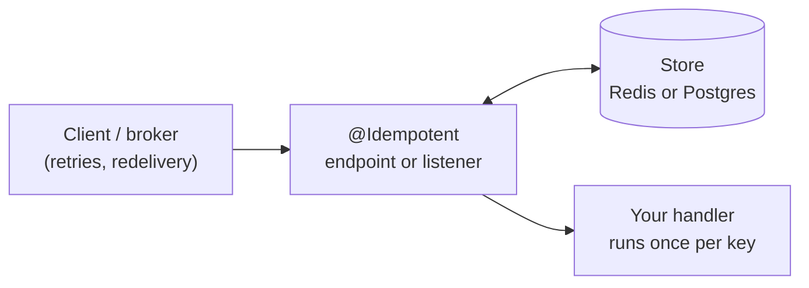
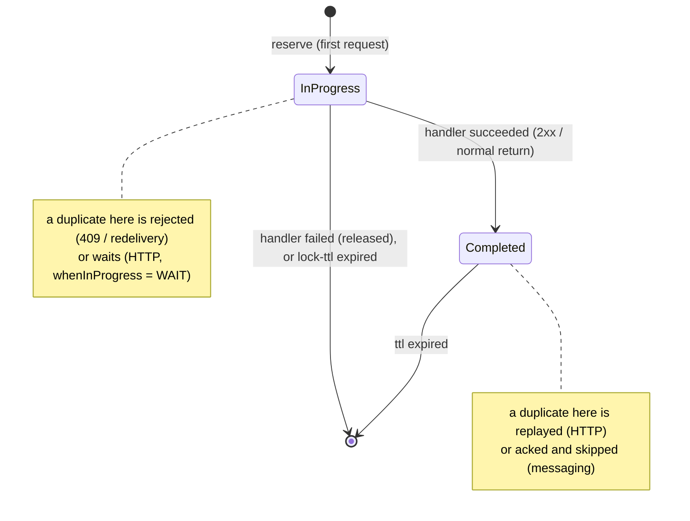

# User Guide — blocks-idempotency

A practical guide to using this library in your own application. For the domain
glossary see `CONTEXT.md`.

## 1. Introduction

`blocks-idempotency` is a drop-in idempotency mechanism for Spring Boot
applications. Mark a REST controller method, or a `@KafkaListener`/
`@RabbitListener`/`@JmsListener` method, with a single `@Idempotent` annotation,
choose where the idempotency key comes from and which store backs it, and the
library takes care of the rest: caching the first response (HTTP) or deduping
the delivery (messaging), rejecting or waiting on concurrent duplicates,
detecting a key that gets reused for a different payload, and degrading sanely
if the store goes down.

It works the same way across four entry-point types — plain HTTP endpoints,
and Kafka, RabbitMQ, and JMS listeners — backed by a choice of storage engines
(in-memory, Redis, Postgres).

**Requirements:** Java 17+, Spring Boot 4.x. The HTTP integration targets
Servlet-based Spring MVC; the messaging integrations target Spring for Apache
Kafka, Spring AMQP and Spring JMS listeners.



## Contents

- [1. Introduction](#1-introduction)
- [2. Why use this](#2-why-use-this)
- [3. Getting started](#3-getting-started)
    - [3.1. Modules](#31-modules)
    - [3.2. Quick start](#32-quick-start)
    - [3.3. The `@Idempotent` annotation](#33-the-idempotent-annotation)
- [4. How it works](#4-how-it-works)
    - [4.1. Request/delivery flow](#41-requestdelivery-flow)
    - [4.2. Idempotency Key vs Effective Key](#42-idempotency-key-vs-effective-key)
    - [4.3. Key format](#43-key-format)
    - [4.4. Choosing an Idempotency Key](#44-choosing-an-idempotency-key)
- [5. Idempotent entrypoints](#5-idempotent-entrypoints)
    - [5.1. Web](#51-web)
    - [5.2. Kafka](#52-kafka)
    - [5.3. RabbitMQ](#53-rabbitmq)
    - [5.4. JMS](#54-jms)
    - [5.5. Shared messaging behavior](#55-shared-messaging-behavior)
- [6. Storage](#6-storage)
    - [6.1. Overview](#61-overview)
    - [6.2. In-memory store](#62-in-memory-store)
    - [6.3. Redis](#63-redis)
    - [6.4. Postgres](#64-postgres)
    - [6.5. Choosing a store](#65-choosing-a-store)
- [7. Limitations](#7-limitations)
- [8. Recipes](#8-recipes)
    - [8.1. Charge a card (external effect, Redis, fail-closed)](#81-charge-a-card-external-effect-redis-fail-closed)
    - [8.2. Create an order (database effect, Postgres, wait for the first request)](#82-create-an-order-database-effect-postgres-wait-for-the-first-request)
    - [8.3. A webhook you don't control (body-field key)](#83-a-webhook-you-dont-control-body-field-key)
    - [8.4. A Kafka consumer that must not process a message twice](#84-a-kafka-consumer-that-must-not-process-a-message-twice)
    - [8.5. Retrying from a client](#85-retrying-from-a-client)
- [9. Configuration reference](#9-configuration-reference)
    - [9.1. Global settings](#91-global-settings)
    - [9.2. Store and transport settings](#92-store-and-transport-settings)
- [10. Observability](#10-observability)
    - [10.1. Configuring metrics](#101-configuring-metrics)
    - [10.2. The `idempotency.outcomes` counter](#102-the-idempotencyoutcomes-counter)
    - [10.3. Logs](#103-logs)
- [11. Performance and sizing](#11-performance-and-sizing)
    - [11.1. Cost per protected call](#111-cost-per-protected-call)
    - [11.2. Store round trips](#112-store-round-trips)
    - [11.3. Memory in the application](#113-memory-in-the-application)
    - [11.4. Store size](#114-store-size)
    - [11.5. Long transactions on Postgres](#115-long-transactions-on-postgres)
    - [11.6. `WAIT` duplicates](#116-wait-duplicates)
- [12. Troubleshooting](#12-troubleshooting)

## 2. Why use this

Retries, double-clicks, and at-least-once message redelivery all cause the
same class of bug: an operation runs more than once — a payment charged
twice, an order created twice. Teams usually reinvent a fix for this with an
ad-hoc unique constraint or a "check before insert," and rarely handle the
hard parts:

- **Concurrent duplicates in flight** — two copies of the same request
  arriving before the first has finished need a decision (reject? wait?) that a
  naive uniqueness check doesn't make.
- **Replaying the *original* response (HTTP)** — a client that retries a successful
  request expects the same response back, not a fresh error from a broken
  unique-constraint violation. (A message listener has no response to replay:
  a duplicate delivery is acked and skipped.)
- **Telling a genuine retry apart from an accidental key reuse** — the same
  key showing up with a *different* payload is a bug in the caller, not a
  retry, and should be rejected loudly rather than silently accepted or
  silently overwritten.
- **Behaving well when the backing store is unavailable** — an ad-hoc
  solution rarely has a considered answer for "what happens if the database
  is down right now," and defaults to either blocking everything or silently
  losing protection. Here you choose per handler: fail open (run unprotected,
  the default) or fail closed (`503`).

Centralizing this logic means one tested implementation, consistent
behavior across every endpoint and listener in the codebase, and storage that
can be swapped (or mixed) per handler without touching business logic. The
stores differ in their guarantees, though: see
[6.5](#65-choosing-a-store).

**Use it when:**
- Clients may retry the same request (network timeouts, double-clicks) or a
  broker may redeliver the same message (consumer restart, missed ack,
  redelivery policy).
- The operation has a side effect that must not run twice — a charge, a
  resource creation, a stock decrement.

**Skip it when:**
- The operation is naturally idempotent already — e.g. a `PUT` that just
  overwrites state with the same values every time.
- It's a pure read with no side effect.
- A duplicate is genuinely harmless (a fire-and-forget notification where
  sending it twice costs nothing) and the extra storage round-trip isn't
  worth paying for.

A few situations the library cannot cover (a reactive stack, asynchronous
handlers with the Postgres store, a hard exactly-once guarantee for an external
call) are listed in [7. Limitations](#7-limitations). Read that before adopting it.

## 3. Getting started

### 3.1. Modules

Group id `io.adzubla.blocks`. Add `core`, plus whichever transport module(s)
your application uses, plus at least one store module. The transports and stores
are separate modules so you don't pull in Kafka, RabbitMQ, JMS, Redis, or JDBC
dependencies you don't need. A single application can mix transports (HTTP
endpoints and message listeners side by side) and stores.

The project is at `0.1.0-SNAPSHOT` and not yet published to a public repository:
build it with `mvn install` and depend on that version from your local repository.

| Artifact                                | Purpose                                                                         |
|-----------------------------------------|---------------------------------------------------------------------------------|
| `blocks-idempotency-core`               | Required. `@Idempotent`, the policy engine, the `IdempotencyStore` abstraction. |
| `blocks-idempotency-web`                | Add for Spring MVC/Servlet REST endpoints. Your app supplies Spring MVC and the servlet container (`spring-boot-starter-web`). |
| `blocks-idempotency-messaging-kafka`    | Add for `@KafkaListener` methods.                                               |
| `blocks-idempotency-messaging-rabbitmq` | Add for `@RabbitListener` methods.                                              |
| `blocks-idempotency-messaging-jms`      | Add for `@JmsListener` methods.                                                 |
| `blocks-idempotency-store-redis`        | Add for a Redis-backed store.                                                   |
| `blocks-idempotency-store-postgres`     | Add for a Postgres-backed store.                                                |

```xml
<dependency>
    <groupId>io.adzubla.blocks</groupId>
    <artifactId>blocks-idempotency-core</artifactId>
    <version>0.1.0-SNAPSHOT</version>
</dependency>
<dependency>
    <groupId>io.adzubla.blocks</groupId>
    <artifactId>blocks-idempotency-web</artifactId>
    <version>0.1.0-SNAPSHOT</version>
</dependency>
<dependency>
    <groupId>io.adzubla.blocks</groupId>
    <artifactId>blocks-idempotency-store-redis</artifactId>
    <version>0.1.0-SNAPSHOT</version>
</dependency>
```

Each store module brings its client with it (`spring-boot-starter-data-redis`,
`spring-boot-starter-jdbc` and the PostgreSQL driver), as the messaging modules
bring their broker client. It auto-configures its `IdempotencyStore` bean once
that client is configured: a `StringRedisTemplate` for Redis (the usual
`spring.data.redis.*` properties), a `JdbcTemplate` and transaction manager for
Postgres (a `DataSource`). `blocks-idempotency-web` does not bring the web starter or a servlet
container: it uses the Spring MVC and servlet API of your application, so your
app needs `spring-boot-starter-web` (or `-webmvc`).

`core` never provides a default store on its own — you need at least one store
module. Each messaging module likewise auto-configures its advice as soon as
its listener annotation is on the classpath alongside `core` and a store
module.

### 3.2. Quick start

A minimal HTTP setup with Redis. Add `core`, `web` and `store-redis` as shown
above, on top of `spring-boot-starter-web`, and have a Redis server running, then:

```properties
spring.data.redis.host=localhost
idempotency.default-store=redis
```

```java
@RestController
class OrderController {

    @PostMapping("/orders")
    @Idempotent(header = Idempotent.IDEMPOTENCY_KEY_HEADER)   // X-Idempotency-Key
    ResponseEntity<Order> create(@RequestBody OrderRequest request) {
        return ResponseEntity.status(201).body(orders.create(request));
    }
}
```

The client generates one key per logical operation and resends the same key on
every retry:

```bash
# First call: the handler runs.
curl -i -X POST localhost:8080/orders -H 'X-Idempotency-Key: 01J9Z3K8Q2' \
     -H 'Content-Type: application/json' -d '{"sku":"A1","qty":2}'
# HTTP/1.1 201

# Retry with the same key and body: the original response, handler not run.
curl -i -X POST localhost:8080/orders -H 'X-Idempotency-Key: 01J9Z3K8Q2' \
     -H 'Content-Type: application/json' -d '{"sku":"A1","qty":2}'
# HTTP/1.1 201
# Idempotency-Replayed: true

# Same key, different body: rejected, handler not run.
curl -i -X POST localhost:8080/orders -H 'X-Idempotency-Key: 01J9Z3K8Q2' \
     -H 'Content-Type: application/json' -d '{"sku":"B7","qty":1}'
# HTTP/1.1 422
# Idempotency-Reject-Reason: collision
```

The listener variants look the same, with the listener annotation in place of
the mapping annotation (see [5. Idempotent entrypoints](#5-idempotent-entrypoints)).

### 3.3. The `@Idempotent` annotation

`@Idempotent` goes on a controller method or a listener method (method level
only, not on a class):

```java
@Idempotent(
    header = Idempotent.IDEMPOTENCY_KEY_HEADER,   // "X-Idempotency-Key"; or fieldPath = "$.order.id"
    store = RedisIdempotencyStore.QUALIFIER,      // "" inherits idempotency.default-store
    ttl = "PT1H",                                 // "" inherits idempotency.default-ttl
    keyRequired = true,                           // fixed default, no global
    onStoreFailure = Idempotent.OnStoreFailure.CLOSED,
    whenInProgress = Idempotent.WhenInProgress.REJECT
)
```

| Property               | Meaning                                                                                                                                                         |
|------------------------|-----------------------------------------------------------------------------------------------------------------------------------------------------------------|
| `header` / `fieldPath` | Where the idempotency key comes from: a header (or message header/property), or a JSONPath into the body. Exactly one is required ([4.2](#42-idempotency-key-vs-effective-key)). |
| `store`                | Which store holds the records (`"redis"`, `"postgres"`, see [6](#6-storage)). `""` inherits `idempotency.default-store`.                                        |
| `ttl`                  | How long a completed response is kept, such as `PT1H` or `1h`. After that the key behaves as a new one. `""` inherits `idempotency.default-ttl`.               |
| `keyRequired`          | Default `true`: a request or delivery without a key is rejected. `false` lets it through unprotected, with nothing stored. It has no global default.            |
| `onStoreFailure`       | What to do when the store is unreachable. `OPEN` runs the handler unprotected, `CLOSED` rejects (`503` for HTTP, redelivery for messaging). `DEFAULT` inherits the global setting. |
| `whenInProgress`       | What to do with a duplicate that arrives while the first request is still running. `REJECT` fails it (`409` for HTTP, redelivery for messaging). `WAIT` blocks until the first request finishes (HTTP only; rejected at startup on a listener). `DEFAULT` inherits the global setting. |

**Duration format.** `ttl` and the `idempotency.*` duration properties accept the
same formats as Spring Boot's own durations. Either a number with a unit:
`500ms`, `30s`, `5m`, `1h`, `2d` (units `ns`, `us`, `ms`, `s`, `m`, `h`, `d`;
a bare number such as `30` means **milliseconds**), or an ISO-8601 duration:
`PT30S`, `PT1H`, `P1D`. An unparseable value fails startup (below).

Every attribute with a global default can be set once under `idempotency.*`
([9. Configuration reference](#9-configuration-reference)) and overridden per
handler. A misconfigured `@Idempotent` fails **application startup**, not the first
request: both or neither of `header`/`fieldPath`, an invalid `ttl`, no store set
or a `store` with no matching bean, `whenInProgress = WAIT` on a message
listener, or an asynchronous handler on the Postgres store.

## 4. How it works

`@Idempotent` is the single declarative entry point, usable on an HTTP
controller method or a message listener method. Whichever transport it's
applied to, the same mechanism runs underneath.

**Terms used from here on.** The first request or delivery to present a key is
the *primary*: it *reserves* the key, and the key is *in progress* while the
handler runs. A reservation is held for at most `lock-ttl`, so a primary that
crashes cannot block its key forever. Any later request or delivery with the
same key is a *duplicate*. A key moves through these states:



For every request or delivery, the same sequence happens:

1. **Resolve the raw key** for this request/delivery, using whichever
   strategy the annotation specifies (a header, or a field in the body).
2. **Build an Effective Key** that scopes that raw key to this specific
   endpoint/listener (and, for HTTP, the calling principal) — see
   [Idempotency Key vs Effective Key](#42-idempotency-key-vs-effective-key).
3. **Reserve** the effective key in the configured store. A fresh key
   proceeds; a key already seen goes through the duplicate/collision/
   in-progress handling described in each transport section below.
4. **Invoke the handler/listener method** for a fresh key, once per reservation. If
   it fails, the key is released and a retry can run it again.
5. **Complete or release** the reservation depending on the outcome — success
   caches the result (HTTP) or simply marks the delivery done (messaging);
   failure releases the key so a genuine retry can proceed.

The decisions (reserve, duplicate, collision, store failure) are made by one
transport-neutral engine in the core module. Each transport (HTTP, Kafka,
RabbitMQ, JMS) has a thin adapter that resolves the key, calls the engine and
invokes your method, so its own request/delivery shape plugs into the same engine
and store. That's why the behavior,
configuration shape, and terminology are consistent everywhere you use
`@Idempotent` — differences between transports are called out explicitly in
each transport's own section further down, rather than being separate
mechanisms.

### 4.1. Request/delivery flow

One decision flow is shared by every transport; only the adapter at the edges
differs (an HTTP interceptor, or a broker-specific advice for
Kafka/RabbitMQ/JMS). What happens to each kind of arrival:

| Arrives | HTTP | Messaging |
|---------|------|-----------|
| First request with this key | The handler runs and a `2xx` response is cached. A non-`2xx` response or an exception releases the key. | The listener runs and the delivery is marked done. An exception releases the key. |
| Duplicate after the first finished, same payload | The cached response is replayed (`Idempotency-Replayed: true`). | Acked and skipped; the listener doesn't run. |
| Duplicate while the first is still running | `409` with `Retry-After`, or it waits for the result with `whenInProgress = WAIT`. | Failed and redelivered later; the listener doesn't run. |
| Same key, different payload | `422` | Dead-lettered. |
| Missing or invalid key | `400` (a missing key passes through unprotected with `keyRequired = false`) | Dead-lettered (same exception). |
| Store unreachable | Runs unprotected (`onStoreFailure = OPEN`) or `503` (`CLOSED`). | Runs unprotected (`OPEN`), or with `CLOSED` the listener isn't invoked: Kafka and JMS leave the message un-acked for redelivery, RabbitMQ rejects it without requeue. |

The HTTP status codes and headers are listed in [5.1](#51-web), and the broker
behavior in [5.2](#52-kafka) to [5.5](#55-shared-messaging-behavior).

### 4.2. Idempotency Key vs Effective Key

**Idempotency Key** — a value that identifies *one intent to perform an
operation*. It's whatever the caller (client or upstream service) supplies to
say "this is the same logical operation as last time." Two requests carrying
the same key mean the same intent; a retry after a timeout should resend the
identical key, not a new one.

You choose, per endpoint/listener, where this raw key comes from:

- **Header strategy** (`header = ...`) — the key comes from a client-supplied
  HTTP header (e.g. `X-Idempotency-Key`) or a broker message header/property.
  This represents the *caller's* intent, and covers network retries or
  double-clicks from a caller that deliberately reuses the same key, or a
  broker redelivering the same message.
- **Body-field strategy** (`fieldPath = ...`) — the key is extracted from a
  field in the request/message body via a JSONPath, e.g.
  `fieldPath = "$.order.id"`. This represents *business identity* and covers
  callers you don't control or coordinate a header with, deduplicated by
  which entity the request refers to.

Exactly one of the two must be set on `@Idempotent` — this is validated at
application startup, not at request time.

By default a missing key fails the request/delivery (`400 key_required` for
HTTP, dead-lettered for messaging). Set `keyRequired = false` to instead let
a request through unprotected when no key is present — nothing is cached or
reserved in that case; it's an explicit opt-out for callers you're willing to
let bypass the mechanism entirely.

**Effective Key** — the single key the library actually uses internally to
look up and reserve storage. It's built by combining the raw key with enough
routing/handler identity that the same raw key from two unrelated
endpoints, listeners, or callers never collides:

- **HTTP**: route (request path) + HTTP method + authenticated principal +
  raw key value.
- **Messaging**: destination (topic/queue) + listener id + raw key value.
  There's no principal equivalent in messaging. The listener id is the
  listener annotation's own `id()` if set, otherwise
  `<fully.qualified.ClassName>#<methodName>`.

The principal fold-in for HTTP is itself configurable:
`idempotency.scope.principal-enabled` (default `true`) turns it on or off
globally, and `idempotency.scope.principal-claim` (default `"sub"`) is an
opaque value passed to a `PrincipalClaimResolver` bean you can register
yourself if you want to scope by something other than
`Principal#getName()` — for example a JWT claim:

```java
@Bean
PrincipalClaimResolver principalClaimResolver() {
    return (principal, claim) -> principal instanceof JwtAuthenticationToken jwt
            ? jwt.getToken().getClaimAsString(claim)
            : null; // null falls back to Principal#getName()
}
```

With no such bean registered, the default resolver ignores `claim` and
always uses `Principal#getName()`.

A request always produces exactly one effective key — the two strategies
above are not stacked checks, and they feed the same underlying mechanism
under the same policy.

**Fingerprint** is a separate, related concept: a hash of the route (or
destination), the handler (HTTP method or listener id) and the normalized
request/message body. For HTTP it also covers
the query string, with parameters in sorted order, so reusing a key with
different query parameters is a collision. It's not part of the
effective key — it's compared against what was stored for that key on a
repeat, to detect the same key being reused for a *different* payload. A
mismatch is a collision (`422` for HTTP, dead-lettered for messaging), not a
normal duplicate. What counts as "the body" for an HTTP form or multipart
request is described under [Web — Behavior](#behavior).

### 4.3. Key format

A raw key is an opaque string that must satisfy two rules:

- **Characters:** only letters (`A-Z`, `a-z`), digits and `_ . : -`. The set is fixed
  and not configurable, so no spaces, slashes, `@`, `=` or non-ASCII characters.
- **Length:** 1 to `idempotency.key.max-length` characters (default `255`).

A UUID, a ULID or an existing business id all fit. A missing or blank key is
`400 key_required` (dead-lettered for messaging), and one that breaks the rules
above is `400 key_invalid`, unless the handler has `keyRequired = false` (a
missing key then passes through unprotected).

With a body-field key, the JSONPath must resolve to a single string, number or
boolean (a number or boolean is used as its text form). A blank string, `null`,
an object, an array, a missing field or malformed JSON counts as no key. The
resulting text must pass the same two rules.

### 4.4. Choosing an Idempotency Key

The one property that matters most: the same raw key must mean "the same
intent, retried" and never "an unrelated intent that happens to reuse a
value." Get this wrong in either direction and the mechanism works against
you — too loose, and unrelated operations dedupe into each other or trip
`collision`; too tight, and legitimate retries stop being recognized as
retries at all.

**Prefer the header strategy when you control the caller.** Generate an
opaque token (a UUID or ULID is the recommended convention, though the
server only enforces the fixed charset `[A-Za-z0-9_.:-]+` and
`idempotency.key.max-length`) **once per logical operation attempt**, before
the first send, and resend that exact value on every retry of that same
attempt — not a fresh one per HTTP call. A new key generated on each retry
defeats the mechanism entirely, since each "retry" then looks like a brand
new operation to the server. This is the right default for anything you
control end-to-end: your own frontend, your own service-to-service calls,
your own message producers.

**Prefer the body-field strategy when you don't control the caller**, or
can't coordinate a dedicated header/property with it — third-party
webhooks, callers integrating against your API without following your
conventions, or a broker producer you don't own. Point `fieldPath` at
whatever field already uniquely identifies the business entity the
operation concerns (an order id, a payment id, an external transaction id)
— something the caller was already going to send you, not a piece of
plumbing they have to add. The requirement is that the field is
**business-unique per intent**: if two logically different operations could
ever share that field's value, they'll collide (`422`) or dedupe into each
other incorrectly.

**On an unauthenticated route, a body-field key is shared by every anonymous
caller.** Without a principal, the key is scoped to the endpoint and the field
value alone. Anyone who can guess an ID can then probe it: `201` means it was
never submitted, `422` means it was (with a different body), `409` means it's
in flight, and an identical body gets the original response replayed. The same
applies everywhere with `idempotency.scope.principal-enabled=false`. Use the
body-field strategy on authenticated routes, or point it at an identifier that
isn't guessable, such as a UUID or ULID rather than a sequential order number.

A practical checklist:
- You don't need to namespace a key by endpoint, listener or user: the effective key already isolates those. Keep it unique only within one endpoint/listener, per logical operation.
- Same value on every retry of the same operation — never regenerated per attempt.
- Different value for every distinct operation, even ones that look similar (e.g. two separate orders from the same user in the same second).
- Opaque and short enough to be cheap to store and log — a UUID/ULID or an existing business id, not a serialized object.
- If you don't control the caller and can't guarantee either of the above, consider `keyRequired = false` for that endpoint/listener instead of guessing — see [4.2](#42-idempotency-key-vs-effective-key).

## 5. Idempotent entrypoints

### 5.1. Web

```java
@PostMapping("/orders")
@Idempotent(header = Idempotent.IDEMPOTENCY_KEY_HEADER)
public ResponseEntity<Order> createOrder(@RequestBody OrderRequest request) {
}
```

A repeat request with the same effective key returns the original response
(status, headers, body) instead of re-executing the handler, flagged with
`Idempotency-Replayed: true`.

The properties are described in [3.3](#33-the-idempotent-annotation). The
settings specific to HTTP (`idempotency.scope.*`, `idempotency.replay.*`,
`idempotency.max-request-body-size`) are in
[9. Configuration reference](#9-configuration-reference).

#### Behavior

- Only `2xx` responses are cached. Any error response, or the handler
  throwing, releases the key so a genuine retry can proceed.
- A concurrent duplicate finding the key in-progress gets an immediate
  `409` (`whenInProgress = REJECT`, the default), or blocks for the
  primary's result (`WAIT`) — the only transport where `WAIT` is supported.
  A `WAIT` caller that runs out of `wait-timeout` gets `409` `timeout` with
  `Retry-After`. So does one whose request thread is interrupted while it
  waits (for example during shutdown); the thread's interrupt status is left
  set.
- Every rejecting outcome is thrown as a typed `IdempotencyException` rather
  than written to the response directly, so it flows through Spring's normal
  exception-handling machinery just like an exception thrown from a
  controller method. A default `@ControllerAdvice`, auto-registered by the
  library, turns each one into a bare status(+headers)/empty-body response.
- The library's servlet filter sits in front of every request, but it only
  reads a request body or buffers a response for a request that reaches an
  `@Idempotent` handler and reserves a key. Every other endpoint in the
  application — form posts, multipart uploads, streaming, server-sent
  events, async results — is left exactly as it would be without the
  library.
- It works behind filters that wrap the request and response, such as
  Spring Security's filter chain.
- **Form posts** (`application/x-www-form-urlencoded`) are supported. The
  body is left for the servlet container to parse, so the fingerprint is
  taken from the request's parameters in sorted order — which includes any
  query-string parameters — rather than from the raw bytes. `fieldPath`
  does not apply to a form body; use `header`.
- **Multipart requests** are keyed and deduplicated, but the body is not
  part of the fingerprint: a different upload sent under the same key is
  replayed as a duplicate, not rejected as a collision.
- **Request bodies are buffered up to `idempotency.max-request-body-size`**
  (1MB by default). This covers every body the library reads itself (JSON
  and other raw bodies); a form post's parameters are parsed by the
  container and bounded by its own limit (e.g. Tomcat's `maxPostSize`). A larger body is rejected with `413 request_too_large`
  as soon as the limit is passed (or before reading, when `Content-Length`
  already exceeds it), so it's never held in memory in full. With the header
  strategy, the key is resolved and validated first: a request missing its
  key, or passing through with `keyRequired = false`, never has its body
  buffered.
- **Async handlers** (`CompletableFuture`, `DeferredResult`, `Callable`) are
  supported with the Redis and in-memory stores: the key is reserved once,
  and the record is completed or released with the asynchronous result.
  They are not supported with the Postgres store, and startup fails if one is
  configured (see [6.4 Postgres](#64-postgres)).
- **Responses are buffered up to `idempotency.max-body-size`** (1MB by
  default), since a replay needs the whole body. A response that outgrows it
  can't be cached anyway, so it is sent on to the client as it is written
  instead of being held in memory, and a duplicate gets `409
  response_unavailable`. The exception is the Postgres store: there the whole
  response stays buffered until the transaction commits, so a failed commit
  can still be reported as `500` instead of the handler's `2xx` ([6.4](#64-postgres)).
  A streaming handler (`StreamingResponseBody`, `SseEmitter`) on an
  `@Idempotent` endpoint reaches the client only once it finishes or has
  produced more than `max-body-size`.

**Status codes at a glance.** Every non-2xx response carries
`Idempotency-Reject-Reason` — a closed vocabulary uniform across all
outcomes, so a client can always tell the root cause apart from any other
error the application itself might return at that status code, without
parsing a body. Only the in-progress-duplicate case additionally carries
`Retry-After`, since it alone means "resend with the same key." The only
response the library ever writes a body for is a `2xx` replay, which
reproduces the original captured response verbatim.

| Status                | Meaning                                                                           | Exception                                 | `Idempotency-Reject-Reason`          | Other headers                          | Body                   |
|-----------------------|-----------------------------------------------------------------------------------|-------------------------------------------|--------------------------------------|----------------------------------------|------------------------|
| `2xx`                 | Fresh execution, or replay of a cached response                                   | —                                         | —                                    | `Idempotency-Replayed: true` on replay | Original response body |
| `409` + `Retry-After` | In-progress duplicate (reject/wait-timeout/released) — safe to retry the same key | `IdempotencyConflictException`            | `in_progress`\|`released`\|`timeout` | `Retry-After`                          | empty                  |
| `409`                 | Effect completed but the response can't be replayed (terminal — don't retry)      | `IdempotencyResponseUnavailableException` | `response_unavailable`               | none                                   | empty                  |
| `422`                 | Same key, different payload (fingerprint collision)                               | `IdempotencyCollisionException`           | `collision`                          | none                                   | empty                  |
| `400`                 | Key required but missing                                                          | `IdempotencyKeyRequiredException`         | `key_required`                       | none                                   | empty                  |
| `400`                 | Key value too long, or outside the allowed charset                                | `IdempotencyKeyInvalidException`          | `key_invalid`                        | none                                   | empty                  |
| `413`                 | Request body over `idempotency.max-request-body-size`                             | `IdempotencyRequestTooLargeException`     | `request_too_large`                  | none                                   | empty                  |
| `503`                 | Store unavailable and `onStoreFailure = CLOSED`                                   | `IdempotencyFailClosedException`          | `store_unavailable`                  | none                                   | empty                  |

One response falls outside this table: with the Postgres store, if the
transaction can't be committed after the handler has already produced its
`2xx`, the client gets a bare `500` with no body and no
`Idempotency-Reject-Reason` (see [6.4 Postgres](#64-postgres)). It is
written after the handler has finished, so a `@ControllerAdvice` can't
reshape it.

**Overriding error responses.** Because these are ordinary exceptions, your
own `@ControllerAdvice` can override any single one of them — declare an
`@ExceptionHandler` for the same exception type (or for the common
`IdempotencyException` supertype). The library's own advice is registered at
the lowest precedence, so an application handler for the same type always
wins, letting you wrap idempotency errors in your standard error body
instead of the library's default empty one:

```java
@ControllerAdvice
class ApiErrorHandler {

    @ExceptionHandler(IdempotencyCollisionException.class)
    ResponseEntity<ErrorBody> handleCollision(IdempotencyCollisionException ex) {
        return ResponseEntity.status(ex.status())
                .body(new ErrorBody("IDEMPOTENCY_COLLISION", ex.getMessage()));
    }
}
```

### 5.2. Kafka

```java
@Idempotent(header = Idempotent.IDEMPOTENCY_KEY_HEADER)
@KafkaListener(id = "orders-listener", topics = "orders")
void onOrderCreated(ConsumerRecord<String, String> record) {
    orderService.create(record.value());
}
```

The listener method must accept a `ConsumerRecord<?, ?>` parameter — the
advice reads the header and body off it for key resolution and
fingerprinting (enforced at startup). The record's value must be the raw
payload, a `String` or `byte[]` (`StringDeserializer`/`ByteArrayDeserializer`);
deserialize it inside the listener. A value already deserialized to an object
can't be fingerprinted, so the delivery fails with
`UnsupportedMessagePayloadException` instead of being silently treated as an
empty body, which would disable collision detection and dead-letter every
`fieldPath` delivery. A `null` value (tombstone) is fingerprinted as empty.
The failure then goes through the container's error handling; since a retry
can't fix it, consider registering it with
`DefaultErrorHandler#addNotRetryableExceptions`.

#### Kafka configuration

```properties
# suffix appended to a delivery's source topic to form its dead-letter topic
idempotency.kafka.dead-letter-suffix=.DLT
```

#### Kafka behavior

A collision or invalid/missing key republishes the message to
`<topic><dead-letter-suffix>` (default `.DLT`) via your application's
`KafkaTemplate`, then acks/skips the original. The template bean is optional at
startup but needed the first time a delivery has to be dead-lettered: without one,
that delivery fails with `IllegalStateException` and goes through the container's
error handling instead of being skipped. Duplicates, in-progress
deliveries and `WAIT` are covered in
[Shared messaging behavior](#55-shared-messaging-behavior).

### 5.3. RabbitMQ

```java
@Idempotent(header = Idempotent.IDEMPOTENCY_KEY_HEADER)
@RabbitListener(id = "orders-listener", queues = "orders")
void onOrderCreated(org.springframework.amqp.core.Message message) {
    orderService.create(message.getBody());
}
```

The listener method must accept a Spring AMQP `Message` parameter.

#### RabbitMQ configuration

There is no RabbitMQ-specific `idempotency.*` property — unlike Kafka/JMS,
dead-lettering here is broker-native rather than library-managed.

#### RabbitMQ behavior

A collision, missing or invalid key, or fail-closed store outage all throw
`AmqpRejectAndDontRequeueException`; the broker then routes the rejected
message per whatever dead-letter exchange/queue you've configured on the
queue itself — this module doesn't own that configuration, so make sure your
queue has a dead-letter policy set up if you want rejected messages captured
rather than dropped. Duplicates, in-progress deliveries and `WAIT` are covered in
[Shared messaging behavior](#55-shared-messaging-behavior).

### 5.4. JMS

```java
@Idempotent(header = "IdempotencyKey")
@JmsListener(id = "orders-listener", destination = "orders")
void onOrderCreated(jakarta.jms.Message message) throws JMSException {
    orderService.create(message.getBody(String.class));
}
```

The listener method must accept a `jakarta.jms.Message` parameter. The
message must be a `TextMessage` or `BytesMessage`. Any other type
(`ObjectMessage`, `MapMessage`, `StreamMessage`, or a body-less `Message`)
can't be fingerprinted, and the delivery fails with
`UnsupportedMessagePayloadException`.

> Unlike the HTTP default header name, JMS property names must be
  Java-identifier-like (JMS message-selector syntax forbids hyphens) — use
  something like `IdempotencyKey` rather than `X-Idempotency-Key`.

#### JMS configuration

```properties
# suffix appended to a delivery's source destination to form its dead-letter destination
idempotency.jms.dead-letter-suffix=.DLQ
```

#### JMS behavior

A collision or invalid/missing key republishes the message to
`<destination><dead-letter-suffix>` (default `.DLQ`) via your application's
`JmsTemplate`, then acks/skips the original. As with Kafka, the template bean is
needed the first time a delivery has to be dead-lettered; without one, that
delivery fails with `IllegalStateException` and is redelivered or handled by the
container. Duplicates, in-progress
deliveries and `WAIT` are covered in
[Shared messaging behavior](#55-shared-messaging-behavior).

#### Broker portability

This module is broker-neutral: it depends only on the `jakarta.jms` API and
Spring's `JmsTemplate`/`@JmsListener` — no vendor-specific classes appear
anywhere in its main sources. It runs unmodified against any JMS
3.1-compliant broker (IBM MQ, ActiveMQ Classic or Artemis, etc.)

Which broker your application talks to is entirely your own configuration,
independent of this library: add that broker's Spring Boot starter and
`ConnectionFactory` beans the same way you would without `@Idempotent` (for
IBM MQ, typically `ibm-mq-spring-boot-starter` plus an `MQConnectionFactory`).

### 5.5. Shared messaging behavior

All three broker integrations accept the same `@Idempotent` properties as
HTTP ([3.3](#33-the-idempotent-annotation)) and share these differences from the
HTTP behavior described in the [Web](#51-web) section:

- **No response replay.** An ordinary duplicate delivery is acked and skipped
  without re-invoking the listener, not replayed — there's no captured response to hand back to a message
  listener the way there is to an HTTP client. This is dedupe-only
  protection.
- **`whenInProgress = WAIT` is rejected at startup.** Blocking a listener
  container thread on another delivery's result risks a broker-side timeout
  — for example, a Kafka consumer sitting still long enough to trigger a
  partition rebalance. Only `REJECT` is supported for every messaging
  transport.
- **A delivery whose key is still in progress is failed, not acked.** The
  listener isn't invoked. The advice throws `DeliveryInProgressException`, so
  the broker redelivers the message: Kafka's error handler retries it,
  RabbitMQ requeues it, and JMS rolls back for redelivery. The in-progress
  holder may be a primary that crashed or couldn't reach the store to
  release, leaving a stale lock until `lock-ttl`. Acking would drop what may
  be the only copy of that message. Once the key resolves, the redelivery
  either runs (the lock expired or was released) or is acked as an ordinary
  duplicate (completed). **Give this exception a retry/backoff budget that
  outlasts `lock-ttl`.** The container defaults don't, so with them a message
  held by a stale lock ends up wherever your container sends exhausted
  retries:
  - **Kafka:** `DefaultErrorHandler` defaults to `FixedBackOff(0, 9)`, which
    gives up within milliseconds. Configure a backoff whose total span
    exceeds `lock-ttl` (it can be classified for this exception type).
  - **RabbitMQ:** a thrown exception is requeued immediately, with no delay,
    which makes a tight loop while the lock holds. Quorum queues
    (RabbitMQ 4.x default delivery-limit 20) drop or dead-letter it almost at
    once. Prefer a delayed-retry topology, such as a dead-letter exchange
    into a TTL'd retry queue (the same shape `onStoreFailure = CLOSED`
    relies on), or raise the delivery limit.
  - **JMS:** redelivery relies on a transacted listener session (Spring
    Boot's default for `@JmsListener`). Plain `AUTO_ACKNOWLEDGE` doesn't
    redeliver. Set the broker's redelivery delay and max attempts (Artemis
    defaults to 10 attempts with no delay) so they span `lock-ttl`.
- **Terminal failures are dead-lettered, not turned into an HTTP status.** A
  missing/invalid key or a fingerprint collision routes the message to a
  dead-letter topic/queue instead of a `422`/`400` response — Kafka and JMS
  republish it themselves; RabbitMQ relies on the broker's own dead-letter
  configuration via a reject-without-requeue.
- **A store outage with `onStoreFailure = CLOSED` never invokes the listener.**
  Kafka and JMS leave the message un-acked, so the broker redelivers it.
  RabbitMQ rejects it without requeue, so it is dead-lettered (or dropped) per
  the queue's own configuration. With `OPEN` the listener runs unprotected.
- **The effective key has no principal.** Its scope is destination
  (topic/queue) + listener id + key value, since there's no HTTP-style
  authenticated principal in a message delivery.
- **The Postgres store's exactly-once guarantee still applies**, as long as
  the listener processes each delivery synchronously on a single thread —
  the same assumption a synchronous MVC controller relies on (see
  [6.4 Postgres](#64-postgres)).

## 6. Storage

### 6.1. Overview

|                  | In-memory                    | Redis                                         | Postgres                                                    |
|------------------|------------------------------|-----------------------------------------------|-------------------------------------------------------------|
| Qualifier        | `"in-memory"` (`InMemoryIdempotencyStore.QUALIFIER`; register the bean yourself) | `"redis"` (`RedisIdempotencyStore.QUALIFIER`) | `"postgres"` (`PostgresIdempotencyStore.QUALIFIER`)         |
| Guarantee        | Best-effort, single instance | Best-effort                                   | Exactly-once, for effects that write to the same database   |
| TTL mechanism    | In-process, `Clock`-driven   | Native Redis key TTL                          | `expires_at` column + a scheduled sweep                     |
| Concurrency      | Polling (~100ms + jitter)    | Polling (~100ms + jitter)                     | Native row lock, blocks until the holder commits/rolls back |
| Production-ready | No — tests/prototypes only   | Yes                                           | Yes                                                         |

Store choice is per endpoint/listener, not per application: register more
than one store module and set `store` on each `@Idempotent` to pick, say,
Redis for one handler and Postgres for another in the same service. Prefer
each store's `QUALIFIER` constant over the bare string literal, so a typo
fails to compile instead of failing at application startup:

```java
import io.adzubla.blocks.idempotency.store.redis.RedisIdempotencyStore;

@Idempotent(header = Idempotent.IDEMPOTENCY_KEY_HEADER, store = RedisIdempotencyStore.QUALIFIER)
public ResponseEntity<Receipt> sendEmail(@RequestBody EmailRequest request) {
}
```

```java
import io.adzubla.blocks.idempotency.store.postgres.PostgresIdempotencyStore;

@Idempotent(header = Idempotent.IDEMPOTENCY_KEY_HEADER, store = PostgresIdempotencyStore.QUALIFIER)
public ResponseEntity<Order> createOrder(@RequestBody OrderRequest request) {
}
```

**Fencing tokens.** Every store implementation, whichever one you use,
guards against the same failure mode: a reservation whose holder has stalled
or crashed and whose `lock-ttl` has expired can be superseded by a fresh
reservation for the same key. If the original, now-stale holder eventually
gets around to completing or releasing its reservation, that call must not
be allowed to clobber the fresh one that has since taken over the key. Each
store hands out an opaque *fence token* at reservation time and requires it
to be echoed back on completion/release; a token that no longer matches the
current reservation is silently ignored rather than applied. You don't
interact with fence tokens directly — they're part of what makes an
abandoned reservation's expiry safe to reclaim without any risk of it
corrupting the caller that reclaimed it.

### 6.2. In-memory store

`InMemoryIdempotencyStore` (in `core`) is the reusable test double used by
the library's own test suite. It is **not** auto-configured and **not
meant for production** — its state is a local in-process map, lost on
restart and not shared across instances. Expired records are evicted every
1024 reservations, so its size follows the records still inside their TTL. Register it yourself only for tests
or a single-instance prototype. Register it as a bean named after its qualifier
(or with that `@Qualifier`) so `store = InMemoryIdempotencyStore.QUALIFIER` finds it:

```java
@Bean(InMemoryIdempotencyStore.QUALIFIER)
IdempotencyStore inMemoryIdempotencyStore() {
    return new InMemoryIdempotencyStore();
}
```

### 6.3. Redis

Qualifier `"redis"` (`RedisIdempotencyStore.QUALIFIER`). Best-effort: fast, but a Redis blip or eviction can lose
a reservation. Requires `spring-boot-starter-data-redis` and a configured
`StringRedisTemplate` (standard `spring.data.redis.*` properties). Lifecycle
rides Redis's own key TTL: reserve holds for `lock-ttl` (~30s by default),
completing switches it to the configured response TTL, and a failure deletes
the key outright.

```properties
# prefix for the hashed record key; namespace multiple apps sharing one Redis instance
idempotency.redis.key-prefix=idempotency:
```

**Use when** the protected effect is external or non-transactional — a
payment gateway call, sending an email, calling another service — where you
want fast protection without a false promise of atomicity with your own
database.

**`lock-ttl` must outlast your slowest handler.** Lifecycle rides the record
key's own TTL, so if a legitimately-slow-but-alive primary runs longer than
`lock-ttl`, the key is already gone by the time it calls `complete()` — the
response is silently dropped (never cached), indistinguishable from a crashed
primary being reclaimed. The effect still ran, but no record of it remains: a
retry with the same key reserves it afresh and **runs the handler again**, and
so can a duplicate that arrives while the slow primary is still running. Set
`lock-ttl` comfortably above your worst-case handler duration. When this
happens, `RedisIdempotencyStore` logs a `WARN` (`... completion no-op for ...
- reservation gone or superseded ...`) so it's visible to an operator instead
of failing silently.

### 6.4. Postgres

Qualifier `"postgres"` (`PostgresIdempotencyStore.QUALIFIER`). Exactly-once *for effects that write to the same
database*: reserving opens the transaction the handler's effect runs in (it
joins transparently via ordinary `@Transactional` or plain JDBC on the same
thread); completing commits the response and the effect together; releasing
rolls back both, so the whole HTTP response stays buffered until the commit,
whatever its size. Concurrency is native — a second reservation blocks on the
row's conflict until the first commits or rolls back, bounded by a
configurable lock timeout, rather than polling. That timeout applies only to
the reservation itself: once the key is reserved, the handler's own
statements run with whatever `lock_timeout` the connection normally has.

Requires `spring-boot-starter-jdbc`, a `DataSource`/`PlatformTransactionManager`,
and the `idempotency_record` table, which **you create** (see below). A built-in
job sweeps expired rows, since Postgres itself has no native TTL. It runs on its
own single thread, so you don't need `@EnableScheduling`.

**Creating the table.** The library does not run any migration itself. Add the
table to your own migrations, under whatever version your migration tool needs.
(It does not ship a Flyway script on Flyway's default `db/migration` location on
purpose: a library-owned `V1` would collide with your own `V1`, or fail
validation against your existing history.) The same script is in the jar at
`META-INF/blocks-idempotency/postgres/V1__idempotency_record.sql`, with comments
explaining each column. Copy it, for example, as `V12__idempotency_record.sql`
for Flyway, or into a Liquibase changeset or a plain SQL file:

```sql
CREATE TABLE idempotency_record (
    route             VARCHAR(512) NOT NULL,
    handler           VARCHAR(255) NOT NULL,
    principal         VARCHAR(255) NOT NULL DEFAULT '',
    idempotency_key   VARCHAR(255) NOT NULL,
    fingerprint       VARCHAR(64)  NOT NULL,
    reservation_token VARCHAR(36)  NOT NULL,
    response_status   SMALLINT,
    response_headers  JSONB,
    response_body     BYTEA,
    created_at        TIMESTAMPTZ  NOT NULL DEFAULT now(),
    expires_at        TIMESTAMPTZ  NOT NULL,
    PRIMARY KEY (route, handler, principal, idempotency_key)
);

CREATE INDEX ix_idempotency_expires_at ON idempotency_record (expires_at);
```

When you upgrade the library, check the release notes for schema changes and
add them as new migrations of your own. Without the table, the first idempotent
request on the Postgres store fails with `relation "idempotency_record" does not
exist`.

```properties
# upper bound a waiter blocks on the reservation row's native lock before giving up
idempotency.postgres.lock-timeout=2s
# disable to sweep expired rows with your own job/cron instead
idempotency.postgres.cleanup.enabled=true
# how often the sweep runs
idempotency.postgres.cleanup.interval=5m
# rows deleted per statement; a sweep repeats until a batch comes back short
idempotency.postgres.cleanup.batch-size=1000
```

**How the cleanup works.** Postgres has no native TTL, so a completed record
(past its `ttl`) or an abandoned reservation (past `lock-ttl`) stays in the table
until a sweep deletes it.

- **Correctness doesn't depend on the sweep.** An expired row is already ignored
  when a key is looked up, and a new reservation for the same key takes it over.
  The sweep only reclaims space, so a late or failed sweep never makes an old
  record dedupe a new request.
- **Schedule.** The job runs on its own single daemon thread, so it needs no
  `@EnableScheduling`. The first sweep runs one `interval` after startup. After
  that, `interval` elapses between the end of one sweep and the start of the next.
- **One sweep.** It deletes rows whose `expires_at` has passed, using the
  database's clock, in batches of `batch-size`. Each batch is a short statement
  committed on its own, which avoids one huge `DELETE` and the lock and WAL
  spike that comes with it. The sweep repeats until a batch deletes fewer rows
  than `batch-size`. The `expires_at` index keeps each batch cheap.
- **It never waits.** A batch uses `FOR UPDATE SKIP LOCKED`, so it skips any row
  another transaction holds: a reservation still open, or a row that a sweep on
  another instance is already deleting. A skipped row is deleted by the sweep
  that holds it, or by a later sweep.
- **Several instances.** Each instance runs its own sweep. They don't block one
  another, and the work simply splits between them.
- **Failure and visibility.** A failed sweep is logged at `ERROR` and the
  schedule continues with the next one. At `DEBUG`, each sweep logs how many rows
  it deleted ([10.3](#103-logs)).

To run the cleanup yourself (a cron job, `pg_cron`), set
`idempotency.postgres.cleanup.enabled=false` and delete in batches, as the
built-in job does:

```sql
DELETE FROM idempotency_record
WHERE ctid IN (
    SELECT ctid FROM idempotency_record
    WHERE expires_at < clock_timestamp()
    LIMIT 1000
    FOR UPDATE SKIP LOCKED);
```

**Size the connection pool for blocked duplicates, not just requests.** With
this store, every in-flight `@Idempotent` request holds a pooled connection
for as long as its handler runs, because the reservation *is* that
connection's open transaction. Every concurrent duplicate of an in-flight
key takes a connection too, blocking on the row lock for up to
`idempotency.postgres.lock-timeout`, and under `whenInProgress = WAIT` for
up to `idempotency.wait-timeout` more. A retry storm against a slow endpoint
can therefore hold the whole pool, and unrelated requests that need a
connection stall. To guard against it:

- Budget the pool for *peak concurrent primaries + peak concurrent
  duplicates*, not just your request concurrency.
- Keep `lock-timeout` short on `REJECT` endpoints. A shorter wait frees the
  duplicate's connection sooner. The trade-off is that a duplicate which
  would have outlasted the primary and been replayed gets `409` +
  `Retry-After` instead, and retries.
- Prefer `REJECT` over `WAIT` for slow handlers on this store, since a `WAIT`
  duplicate holds its connection for the whole wait.
- Watch the pool's own metrics (e.g. Hikari's `hikaricp.connections.pending`)
  alongside the `idempotency.outcomes` `concurrency` count.

**Use when** the protected effect is itself a write to this same Postgres
database — creating an order row, for instance — and you want a real
exactly-once guarantee rather than best-effort caching.

**A failed commit is reported, not hidden.** The handler's writes only
become durable when the store commits, which happens after the handler has
returned. If that commit fails — the connection dropped, a constraint
deferred to commit time, or the transaction was marked rollback-only by an
inner `@Transactional` call whose exception the handler caught — the
handler's writes and the reservation are rolled back together. Over HTTP
the handler's buffered `2xx` is discarded and the client gets a bare `500`;
headers set earlier in the request are cleared with it. For a message
listener the delivery fails and is left to the broker to redeliver. Either
way the key is free again, so a retry re-executes.

**Not supported with async handlers** (`Callable`/`DeferredResult`/
`CompletableFuture`/`WebAsyncTask`, streaming bodies such as
`StreamingResponseBody`/`SseEmitter`, reactive types, and any of these
wrapped in `ResponseEntity`). They complete on a different thread than the
one that reserved the key, which breaks the thread-bound transaction this
store relies on: the result would never be committed, and the open
transaction would stay bound to a pooled servlet thread. **Startup fails**
for such a handler on the Postgres store, naming the handler and its return
type. Use a synchronous handler with the Postgres store. The same thread-bound assumption extends to message
listeners — it works as long as the listener processes each delivery
synchronously on a single thread, which is the default for
`@KafkaListener`/`@RabbitListener`/`@JmsListener`. As a safety net, if a
reservation is ever left unresolved on a thread anyway, the next reservation
for a different key on that thread rolls it back (logged at `WARN`) instead of
joining its transaction.

**Long key components.** The schema's key columns are `VARCHAR(512)` for the
route and `VARCHAR(255)` for the handler, principal and key value. A component
longer than its column (a long request URI, a long principal claim, a
`key.max-length` above 255) is stored as `sha256:<hex>` of its value instead,
so it still works; values that fit are stored verbatim.

### 6.5. Choosing a store

| Your situation | Use |
|----------------|-----|
| The effect is a write to your own Postgres database, and the handler is synchronous | **Postgres**: the effect and the idempotency record commit together, so it is exactly-once. |
| The effect is outside your database (a payment gateway, an email, another service) | **Redis**: fast, but best-effort. Pass the key downstream too if you need more. |
| The effect writes to Postgres, but the handler is asynchronous (`CompletableFuture`, `DeferredResult`, streaming) | **Redis**: the Postgres store doesn't support asynchronous handlers. |
| Tests, or a single-instance prototype | **In-memory**: not for production. |

Both stores can be registered side by side and chosen per endpoint ([6.1](#61-overview)).
For what each store costs per call and how to size it, see [11](#11-performance-and-sizing).

## 7. Limitations

Where the library does not apply, or its guarantee is weaker than you might
assume:

| Situation | What happens | What to do instead |
|-----------|--------------|--------------------|
| **Reactive stack (WebFlux)** | The HTTP integration is a Servlet filter and Spring MVC interceptor; it does not apply. | Use the messaging modules or build on `core` directly. |
| **Postgres store with an async handler** (`CompletableFuture`, `DeferredResult`, `Callable`, streaming, reactive return types) | **Application startup fails.** The reservation is the reserving thread's open transaction, which an async handler would leave behind. | Make the handler synchronous, or use Redis for that endpoint. |
| **Side effect outside your database, needing a hard guarantee** (payment gateway, email) | Redis is best-effort. A Redis eviction, a handler that outlasts `lock-ttl`, or (with the default fail-open posture) a Redis outage lets a retry run the effect again. | Pass your own idempotency key to the downstream system as well. No store can make an external call exactly-once. |
| **Exactly-once on Postgres, but the effect writes elsewhere** | The guarantee only covers writes made in the same database and transaction as the idempotency record. For an effect elsewhere, Postgres is no stronger than Redis. | Pick the store on other grounds (Redis doesn't hold a database connection for the whole handler) and pass your own key downstream. |
| **Fail-open posture** (`onStoreFailure=OPEN`, the default) | While the store is down, requests run unprotected, so duplicates are not prevented. | Set `CLOSED` on endpoints where a duplicate is worse than a `503`. |
| **Large or streaming HTTP responses** | A response over `idempotency.max-body-size` (1MB) is not cached, so a duplicate gets `409 response_unavailable` instead of a replay. Up to that size the response is buffered before it is sent; on the Postgres store it is buffered in full. | Raise the limit, or don't mark such endpoints `@Idempotent`. |
| **Request bodies over `idempotency.max-request-body-size`** (1MB) | Rejected with `413 request_too_large`, whichever key strategy you use. | Raise the limit, or send a smaller body. |
| **Messaging: you want the original result replayed** | Messaging is dedupe-only. A duplicate is acked and skipped; nothing is cached or replayed. | Make the listener's effect observable elsewhere (a row, an event). |
| **Messaging: `whenInProgress = WAIT`** | Rejected at startup. Only `REJECT` is supported. | Give in-progress deliveries a retry/backoff budget (see [5.5](#55-shared-messaging-behavior)). |
| **Messaging: payloads already deserialized to objects** | The delivery fails with `UnsupportedMessagePayloadException`. Kafka needs a `String`/`byte[]` value, JMS a `TextMessage`/`BytesMessage`. | Use raw deserializers and deserialize inside the listener. |
| **Multipart or form requests** | A multipart body is not part of the fingerprint, so a different upload under the same key replays as a duplicate. `fieldPath` doesn't apply to a form body. | Use a header key. |
| **Unauthenticated route with a body-field key** | Every anonymous caller shares one key space, so an ID can be probed from outside ([4.4](#44-choosing-an-idempotency-key)). | Use a header key, authenticate the route, or use unguessable IDs. |
| **Postgres store under a retry storm** | Every in-flight request and every blocked duplicate holds a pooled connection ([6.4](#64-postgres)). | Size the pool for duplicates, keep `lock-timeout` short, prefer `REJECT`. |
| **Class-level annotation** | `@Idempotent` is method-level only. | Annotate each handler method. |
| **A key that must live longer than its TTL** | An expired key behaves as a brand-new one, and the operation runs again (default TTL 24h). | Raise `ttl` for that endpoint. |
| **Using it as a distributed lock or ordering mechanism** | It deduplicates one key's operation. It doesn't serialize different keys or order operations. | Use a lock or a queue designed for that. |

## 8. Recipes

### 8.1. Charge a card (external effect, Redis, fail-closed)

A duplicate charge is worse than a brief outage, so reject rather than run
unprotected when Redis is down. Give the handler a generous `lock-ttl`
(configured globally) and pass the key on to the gateway as well.

```java
@PostMapping("/payments")
@Idempotent(header = Idempotent.IDEMPOTENCY_KEY_HEADER,
        store = RedisIdempotencyStore.QUALIFIER,
        onStoreFailure = Idempotent.OnStoreFailure.CLOSED)
ResponseEntity<Receipt> pay(@RequestBody PaymentRequest request,
                            @RequestHeader("X-Idempotency-Key") String key) {
    return ResponseEntity.ok(gateway.charge(request, key));   // forward the key downstream
}
```

### 8.2. Create an order (database effect, Postgres, wait for the first request)

The order row and the idempotency record commit together, so a retry can
never see one without the other. `WAIT` makes a concurrent duplicate block until
the first request finishes, then return its response. The wait is bounded
(`idempotency.postgres.lock-timeout`, then `idempotency.wait-timeout`), after which
the duplicate gets `409` with `Retry-After`.

```java
@Transactional
@PostMapping("/orders")
@Idempotent(header = Idempotent.IDEMPOTENCY_KEY_HEADER,
        store = PostgresIdempotencyStore.QUALIFIER,
        whenInProgress = Idempotent.WhenInProgress.WAIT)
ResponseEntity<Order> create(@RequestBody OrderRequest request) {
    return ResponseEntity.status(201).body(orders.save(request));
}
```

Keep the handler synchronous, and size the connection pool for blocked
duplicates ([6.4](#64-postgres)).

### 8.3. A webhook you don't control (body-field key)

The sender includes its own event id. Use it as the key instead of asking for a
header, and keep the route authenticated so the key isn't shared by anonymous
callers ([4.4](#44-choosing-an-idempotency-key)). A sender that retries an event
with a changed body (a new timestamp or attempt counter) gets `422 collision`
rather than a replay, because the body is part of the fingerprint.

```java
@PostMapping("/webhooks/payments")
@Idempotent(fieldPath = "$.event.id", store = RedisIdempotencyStore.QUALIFIER)
ResponseEntity<Void> onEvent(@RequestBody PaymentEvent event) {
    handler.apply(event);
    return ResponseEntity.noContent().build();
}
```

### 8.4. A Kafka consumer that must not process a message twice

With Redis this is best-effort; use the Postgres store when the effect is a write to
the same database. Use raw deserializers, accept the `ConsumerRecord`, and give redelivery of
in-progress messages a backoff longer than `lock-ttl`.

```java
@Idempotent(header = "Idempotency-Key", store = RedisIdempotencyStore.QUALIFIER)
@KafkaListener(id = "orders-listener", topics = "orders")
void onOrder(ConsumerRecord<String, String> record) {
    orderService.create(record.value());
}

@Bean
DefaultErrorHandler kafkaErrorHandler() {
    // retry DeliveryInProgressException for longer than idempotency.lock-ttl (30s)
    return new DefaultErrorHandler(new FixedBackOff(5_000, 10));
}
```

### 8.5. Retrying from a client

The key must be created once per operation and reused on every retry:

```java
String key = UUID.randomUUID().toString();          // once, before the first attempt
for (int attempt = 1; ; attempt++) {
    ResponseEntity<Order> response = client.post("/orders", body, key);
    if (!response.getHeaders().containsKey("Retry-After") || attempt == 5) {
        return response;
    }
    // Retry-After (a 409) means "in progress": wait, then resend the same key.
    Thread.sleep(retryAfterMillis(response));
}
```

Don't retry `409 response_unavailable` (the effect already ran) or `422
collision` (a bug in the caller).

## 9. Configuration reference

Every setting has a default except `idempotency.default-store`, so a working
setup needs only that one. Durations take Spring Boot formats (`30s`, `5m`,
`PT30S`; a bare number is milliseconds, see [3.3](#33-the-idempotent-annotation)) and sizes take `1MB`-style values.

### 9.1. Global settings

The first four are the global defaults for the `@Idempotent` attributes of the
same name ([3.3](#33-the-idempotent-annotation)); an explicit attribute on the
annotation always wins.

| Property | Default | Applies to | Meaning |
|----------|---------|------------|---------|
| `idempotency.default-store` | none, **required** unless every `@Idempotent` sets `store` | all | Store qualifier (`redis`, `postgres`, or `in-memory` if you registered that store). Startup fails if it is empty and an `@Idempotent` doesn't set its own. |
| `idempotency.default-ttl` | `24h` | all | How long a completed response is kept. |
| `idempotency.default-on-store-failure` | `OPEN` | all | `OPEN` or `CLOSED`. `DEFAULT` is not allowed here. |
| `idempotency.default-when-in-progress` | `REJECT` | all | `REJECT` or `WAIT`. `DEFAULT` is not allowed here, and `WAIT` fails startup for messaging listeners. |
| `idempotency.lock-ttl` | `30s` | all | How long a reservation is held before an abandoned one is treated as gone. Set it above your slowest handler ([6.3](#63-redis)). |
| `idempotency.wait-timeout` | `5s` | HTTP | How long a `WAIT` duplicate blocks for the first request's result before getting `409 timeout`. |
| `idempotency.poll-interval` | `100ms` | HTTP | Delay between `WAIT` polls, for stores without a native blocking wait. Postgres ignores it. |
| `idempotency.poll-jitter` | `50ms` | HTTP | Random extra delay added to each poll, up to this much. Postgres ignores it. |
| `idempotency.max-body-size` | `1MB` | HTTP | A response over this size is not cached, so a duplicate gets `409 response_unavailable`. It is also the most of a response that is held in memory: a larger one is streamed to the client (except on the Postgres store, which buffers the whole response until it commits). |
| `idempotency.max-request-body-size` | `1MB` | HTTP | A request body over this size is rejected with `413 request_too_large` while buffering. |
| `idempotency.key.max-length` | `255` | all | Longest accepted raw key. A longer key, or one outside the fixed charset `[A-Za-z0-9_.:-]`, is rejected (`400 key_invalid` / dead-lettered). |
| `idempotency.scope.principal-enabled` | `true` | HTTP | Include the authenticated principal in the effective key. |
| `idempotency.scope.principal-claim` | `sub` | HTTP | Passed unchanged to the `PrincipalClaimResolver` bean. The default resolver ignores it and uses `Principal#getName()`. |
| `idempotency.replay.header-name` | `Idempotency-Replayed` | HTTP | Header that flags a replayed response. |
| `idempotency.replay.header-denylist` | `Date,Set-Cookie,traceparent,tracestate` | HTTP | Headers not reproduced on a replay. `Set-Cookie` is never replayed, even if you remove it from this list. |
| `idempotency.metrics.enabled` | `true` | all | Record the `idempotency.outcomes` counter ([10](#10-observability)). Needs a `MeterRegistry` bean. |

### 9.2. Store and transport settings

| Property | Default | Meaning |
|----------|---------|---------|
| `idempotency.redis.key-prefix` | `idempotency:` | Prefix of the hashed record key. Namespaces several applications sharing one Redis ([6.3](#63-redis)). |
| `idempotency.postgres.lock-timeout` | `2s` | How long a duplicate blocks on the reservation row's lock before giving up ([6.4](#64-postgres)). |
| `idempotency.postgres.cleanup.enabled` | `true` | Run the scheduled sweep of expired rows. Disable it to sweep with your own job. |
| `idempotency.postgres.cleanup.interval` | `5m` | Delay between sweeps. |
| `idempotency.postgres.cleanup.batch-size` | `1000` | Rows deleted per statement. A sweep repeats until a batch comes back short. |
| `idempotency.kafka.dead-letter-suffix` | `.DLT` | Appended to the source topic to form the dead-letter topic ([5.2](#52-kafka)). |
| `idempotency.jms.dead-letter-suffix` | `.DLQ` | Appended to the source destination to form the dead-letter destination ([5.4](#54-jms)). |

RabbitMQ has no setting of its own: dead-lettering is configured on the queue
in the broker ([5.3](#53-rabbitmq)).

Example, for an HTTP service that uses Postgres and a longer reservation:

```properties
idempotency.default-store=postgres
idempotency.lock-ttl=60s
idempotency.postgres.lock-timeout=1s
```

## 10. Observability

### 10.1. Configuring metrics

Metrics are emitted through Micrometer, so they show up wherever your
application already ships meters (Prometheus, CloudWatch, Datadog, ...) with
no extra wiring beyond having a `MeterRegistry` bean, which Spring Boot
Actuator provides automatically.

Metrics are on by default (`idempotency.metrics.enabled=true`, see
[9](#9-configuration-reference)). Recording falls back to a no-op
implementation — same code path, zero overhead, nothing throws — whenever
either condition isn't met:
- `idempotency.metrics.enabled=false` (default `true`), or
- no `MeterRegistry` bean is on the context (e.g. Actuator isn't on the
  classpath).

The registry is looked up when the metrics bean is created, so it doesn't
matter whether it comes from Spring Boot's auto-configuration or from a
bean you define yourself.

You can also supply your own `IdempotencyMetrics` bean instead of the
built-in Micrometer one — it wins over auto-configuration automatically
(`@ConditionalOnMissingBean`), useful if your application already has a
bespoke metrics pipeline.

Emission is centralized in the transport-neutral engine, not duplicated per
adapter: every outcome below fires from exactly one call site regardless of
whether the request came in over HTTP, Kafka, RabbitMQ, or JMS.

### 10.2. The `idempotency.outcomes` counter

One counter, `idempotency.outcomes`, dimensioned by an `outcome` tag rather
than seven separate counter names — sum or group by `outcome` in your
dashboard/alerting rule of choice. It's also tagged with `route` and
`handler` (the same identity that appears in the logs — request path and
HTTP method for web, destination and listener id for messaging), so you can
attribute an outcome to a specific endpoint or listener instead of only seeing
an application-wide total. The raw key value itself is never a tag, since it is
unbounded.

**Watch the `route` tag on HTTP endpoints with path variables.** `route` is the
actual request path, so `@PostMapping("/orders/{id}")` produces one series per
distinct id (`/orders/42`, `/orders/43`, ...). Endpoints with fixed paths, and
messaging destinations, are bounded. If you have path variables, collapse them
with a Micrometer `MeterFilter`:

```java
@Bean
MeterFilter idempotencyRouteCardinality() {
    return MeterFilter.replaceTagValues("route",
            route -> route.replaceAll("/\\d+", "/{id}"));   // adapt to your paths
}
```

(A `MeterFilter` applies to every meter with a `route` tag. To limit it to
this counter, check `id.getName()` in a custom `MeterFilter` instead.)

| `outcome` tag          | Fires when                                                                               | Normal or abnormal?                                               | Operator response                                                                                                                                                                                                                                                                                                                                                                     |
|------------------------|------------------------------------------------------------------------------------------|-------------------------------------------------------------------|---------------------------------------------------------------------------------------------------------------------------------------------------------------------------------------------------------------------------------------------------------------------------------------------------------------------------------------------------------------------------------------|
| `replay`               | HTTP only. A completed record's cached response is replayed instead of re-executing the handler. | **Normal.** This is the mechanism working as intended. | None. A sustained *high* rate just means clients are retrying a lot — worth knowing about network conditions upstream, but not an idempotency problem. |
| `collision`            | The same key showed up with a *different* payload (fingerprint mismatch, `422`).         | **Abnormal.** Always a bug or misuse, never routine.              | Investigate the caller: a client reusing idempotency keys across distinct requests, or a body-field key (`fieldPath`) pointing at a value that isn't actually unique per intent. Not a store or infra problem.                                                                                                                                                                        |
| `concurrency`          | A duplicate found the key in progress and was rejected (`409` for HTTP, redelivery for messaging), or a `WAIT` caller timed out or found the key released. | **Expected at some baseline** under legitimate racing retries.    | Watch the *rate*, not raw occurrences. A rising trend suggests handlers are running slower than clients expect (tune `wait-timeout`), or a caller is retrying too aggressively before the first attempt could finish.                                                                                                                                                                 |
| `fail_open`            | The store was unavailable and `onStoreFailure=OPEN` let the request through unprotected. | **Abnormal — store health incident.**                             | Page/alert. During this window, duplicate side effects are *not* being prevented. Check store connectivity/latency/capacity immediately; this is the metric that tells you protection is currently off.                                                                                                                                                                               |
| `fail_closed`          | The store was unavailable and `onStoreFailure=CLOSED` rejected the request (`503` for HTTP; for messaging the listener isn't invoked and the delivery is redelivered or rejected). | **Abnormal — store health incident, with visible client impact.** | Page/alert, same root cause as `fail_open` (store outage) but here clients are seeing failures directly. Check store connectivity/latency/capacity; consider whether `OPEN` is more appropriate for this endpoint's risk profile.                                                                                                                                                     |
| `response_unavailable` | HTTP only. A duplicate found a completed record whose response can't be replayed (`409`, no `Retry-After`). | **Abnormal if sustained.** | The original response exceeded `idempotency.max-body-size` (raise the limit if these are legitimate responses), or the capture filter isn't in the filter chain (look for the `IdempotencyFilter is not in the filter chain` `WARN`). Retrying the same key can never succeed once this fires, so this is a signal to fix configuration, not to expect self-healing. |
| `duplicate_skipped`    | Messaging only. A duplicate delivery of an already-processed key was acked and skipped without invoking the listener. | **Normal.** The messaging equivalent of `replay`. | None. A sustained *high* rate just means the broker is redelivering a lot (consumer restarts, missed acks). |

### 10.3. Logs

All log output goes through SLF4J under the package `io.adzubla.blocks.idempotency`,
so the standard Spring Boot `logging.level.*` properties control it. The default
level (`INFO`) shows startup validation and anything that needs attention. Raise
a package to `DEBUG` to see every decision for a request or delivery.

```properties
# everything the library logs, per request/delivery
logging.level.io.adzubla.blocks.idempotency=DEBUG
# or only one area, for example just the decisions (reserve, replay, collision, ...)
logging.level.io.adzubla.blocks.idempotency.engine=DEBUG
```

In the table, `...` stands for `io.adzubla.blocks.idempotency`.

| Level | Logger (package) | What you see |
|-------|------------------|--------------|
| `INFO` | `...validation`, `...messaging.core.validation` | At startup, one line per `@Idempotent` endpoint or listener with its key strategy and store, then `Idempotency configuration valid: N @Idempotent endpoint(s) validated`. If this line is missing, nothing was registered ([12](#12-troubleshooting)). |
| `WARN` | `...engine` | The store is unavailable and the request was failed open or closed. A store failure while completing or releasing a key (the response isn't cached, or the key stays reserved until `lock-ttl`). |
| `WARN` | `...web` | `IdempotencyFilter is not in the filter chain`: responses can't be captured, so duplicates get `409 response_unavailable`. |
| `WARN` | `...messaging.kafka`, `...messaging.rabbitmq`, `...messaging.jms` | The store is unavailable with `onStoreFailure=CLOSED`: the listener was not invoked and the message was left for redelivery. |
| `WARN` | `...store.redis` | The store is unreachable. Also `completion no-op ... reservation gone or superseded`: a handler outlasted `lock-ttl`, so its response wasn't cached ([6.3](#63-redis)). No metric records this, so alert on the log line. |
| `WARN` | `...store.postgres` | The store is unreachable. A commit failed and the effect was rolled back. A reservation left unresolved on a thread was rolled back ([6.4](#64-postgres)). |
| `ERROR` | `...web` | The Postgres commit failed after the handler succeeded, so the client got `500` instead of the handler's response. |
| `ERROR` | `...store.postgres` | The expired-row sweep failed ([6.4](#64-postgres)). |
| `DEBUG` | `...engine` | Each decision, tagged with route, handler and key: reserved, replayed, collision, concurrent duplicate rejected (with the reason), response unavailable, duplicate skipped, completed (with status), released, and a `WAIT` interrupted before the key resolved. |
| `DEBUG` | `...web` | A request rejected for a missing or invalid key. |
| `DEBUG` | `...messaging.core`, `...messaging.kafka`, `...messaging.rabbitmq`, `...messaging.jms` | A duplicate delivery acked without invoking the listener, a delivery failed for redelivery because its key is in progress, and a delivery routed to dead-lettering (with the reason). |
| `DEBUG` | `...store.postgres` | A reservation that hit the lock timeout and was treated as in progress, and how many expired rows each sweep deleted. |

Which level answers which question:
- *"Why did this request get a 409/422, or run twice?"* Set `...engine` to `DEBUG`. Each outcome is one line.
- *"Why was this message skipped, redelivered or dead-lettered?"* Set `...messaging` to `DEBUG`.
- *"Is the store healthy?"* Watch `WARN` and above. They are on by default, and each store-unavailable event is logged whatever the `onStoreFailure` posture.
- *"Is protection on at all?"* The startup `INFO` lines.

The `DEBUG` lines include the raw key value, which can be a business identifier
such as an order id. Leave `DEBUG` off in production unless you are tracing a
specific problem, or confirm that your keys aren't sensitive.

## 11. Performance and sizing

What a protected call costs, and how to size the application and the store for it.

### 11.1. Cost per protected call

Before the store is called, the library resolves the key and fingerprints the
request. The fingerprint parses a JSON body and writes it back out with sorted
keys, so it costs roughly 10 µs for a 1KB body, 0.5 ms for 100KB and 5 ms for
1MB, and creates about 14 times the body size in short-lived garbage (measured
on one development machine; read these as orders of magnitude). A body-field
key reads the same parsed body, so it adds little on top. Every protected call
pays this, duplicates and replays included. Keep
`idempotency.max-request-body-size` close to the bodies you really expect. A
non-JSON body is hashed as it is, at a fraction of the cost.

### 11.2. Store round trips

| Store | First call | Duplicate | Held while the handler runs |
|---|---|---|---|
| Redis | 2 (reserve, complete) | 1 (reserve returns the existing record) | nothing |
| Postgres | 3 (reserve, write the response, commit) | 3 (reserve, read the record, commit), after waiting on the row lock, for up to `idempotency.postgres.lock-timeout`, if the first call is still in flight | a pooled connection and an open transaction |
| In-memory | 0 | 0 | nothing |

A non-2xx or a thrown exception replaces "complete" with "release": one round
trip for Redis, a rollback for Postgres.

### 11.3. Memory in the application

A protected request holds its body (up to `max-request-body-size`) and its
response (up to `max-body-size`) in memory, plus the copies made while caching
it and, briefly, the parsed JSON body ([11.1](#111-cost-per-protected-call)).
A response larger than `max-body-size` is streamed to the client instead,
except on the Postgres store, which keeps the whole response until it commits
([5.1](#51-web)). Don't put `@Idempotent` on large downloads behind the
Postgres store.

### 11.4. Store size

Each completed record is kept for the endpoint's `ttl` (24h by default), so
the store holds about *rate of new keys × `ttl`* records (duplicates add
none), each the size of its cached response plus a few hundred bytes of key,
fingerprint and headers. For example, 100 requests/s with 2KB responses and
the default `ttl` is about 8.6 million records:

- **Redis** stores the body Base64-encoded (a third larger), so that's roughly
  25GB. Budget `maxmemory` for it. Every record has a TTL, so any eviction
  policy other than `noeviction` (including the `volatile-*` ones) can evict
  live records, and a retry of an evicted key runs the handler again. With
  `noeviction`, a full Redis rejects new reservations instead, and the
  endpoint's `onStoreFailure` posture applies; a request already running when
  Redis fills up can't save its response, so a retry of it runs the handler
  again. A shorter `ttl` on high-volume endpoints is the main lever, and a
  lower `idempotency.max-body-size` caps the size of each record.
- **Postgres** compresses large bodies, but the table and its primary-key
  index (the full route, handler, principal and key, not a digest) still grow
  with the same formula. Each new key writes its row twice (the reservation,
  then the response), leaving one dead row version behind, and the cleanup
  sweep's deletes leave one more per expired row. Autovacuum reclaims them, so
  check that it keeps up on this table at your write rate.

### 11.5. Long transactions on Postgres

The reservation is the handler's own open transaction, so a slow handler is a
long transaction. Besides holding a pooled connection ([6.4](#64-postgres)):

- A handler that spends time outside the database, such as calling another
  service, leaves its connection *idle in transaction*. If the database or
  role sets `idle_in_transaction_session_timeout`, Postgres closes such a
  session, and the request fails when it completes (a `500` over HTTP; a
  failed delivery for a listener). Keep that timeout above your slowest
  handler, or keep slow external calls off Postgres-protected endpoints.
- An open transaction holds back vacuum for the whole database while it runs,
  so many slow handlers can make tables bloat. Keep Postgres-protected handlers
  short.

### 11.6. `WAIT` duplicates

`WAIT` is HTTP only (message listeners reject it at startup). A `WAIT` duplicate
holds its request thread for up to `idempotency.wait-timeout` (5s). On Redis it
polls the store about every `poll-interval` plus jitter (100–150ms by default),
so a burst of waiting duplicates is a burst of reads. On Postgres it blocks on
the row lock and holds a connection instead. Under heavy retry traffic, prefer
`REJECT`: on Redis it costs one store call and frees the thread at once; on
Postgres it still waits on the row lock for up to
`idempotency.postgres.lock-timeout`, so keep that short ([6.4](#64-postgres)).

## 12. Troubleshooting

| Symptom | Likely cause |
|---------|--------------|
| Application fails to start naming an `@Idempotent` handler | Both or neither of `header`/`fieldPath`, an invalid `ttl`, no store set or a `store` with no matching bean, `WAIT` on a messaging listener, a listener without a `ConsumerRecord`/`Message` parameter, or an async handler on the Postgres store. |
| Every call executes the handler, with no errors | The transport module (`web` or a messaging module) is missing from the classpath, so `@Idempotent` is ignored; check the startup log for `Idempotency configuration valid: N @Idempotent endpoint(s) validated`. Or the caller sends no key and the handler has `keyRequired = false`, or the store is down with the default `onStoreFailure = OPEN` (`fail_open` metric, `WARN` logs). A missing store module fails startup instead. |
| Retries are not recognized as retries | The client generates a new key on each attempt, or the key comes from a field that differs between attempts. |
| `422 collision` on a legitimate retry | The body or query string changed between attempts (including a timestamp inside the body), or a `fieldPath` value isn't unique per intent. |
| `409 response_unavailable` | The response was over `idempotency.max-body-size`, or the capture filter isn't in the filter chain (`WARN` in the log). Not retryable. |
| `400 key_required` | The request has no key and the handler requires one (`keyRequired = true`, the default). |
| `413 request_too_large` | The request body is over `idempotency.max-request-body-size`. |
| `503 store_unavailable` | The store is unreachable and the handler has `onStoreFailure = CLOSED`. |
| `409 in_progress` that never clears | The first request is still running, or it crashed. The key frees itself once `lock-ttl` expires. |
| `400 key_invalid` | The key is longer than `idempotency.key.max-length` or contains characters outside `[A-Za-z0-9_.:-]`. |
| `relation "idempotency_record" does not exist` on the Postgres store | The table was never created. Add it to your migrations ([6.4](#64-postgres)). |
| Handler ran twice on Redis | `lock-ttl` is shorter than the handler (look for the `completion no-op` `WARN`), Redis lost the key (eviction), or Redis was down with `onStoreFailure = OPEN`. |
| `500` after a successful handler on Postgres | The commit failed and the effect was rolled back. A retry re-executes ([6.4](#64-postgres)). |
| Messages requeued in a tight loop (RabbitMQ), or dropped after a few quick retries (Kafka default error handler) | A delivery whose key is still in progress has no retry backoff longer than `lock-ttl` ([5.5](#55-shared-messaging-behavior)). |
